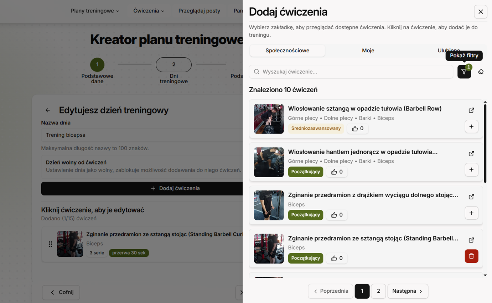
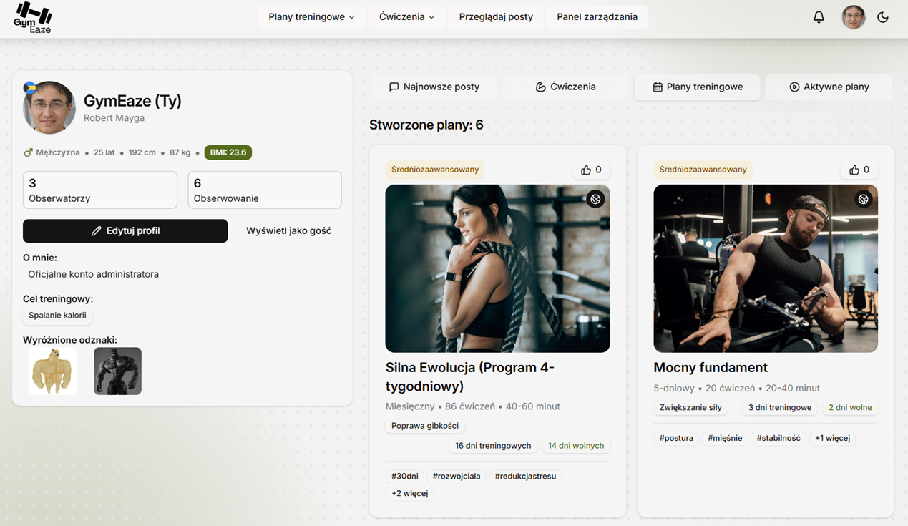
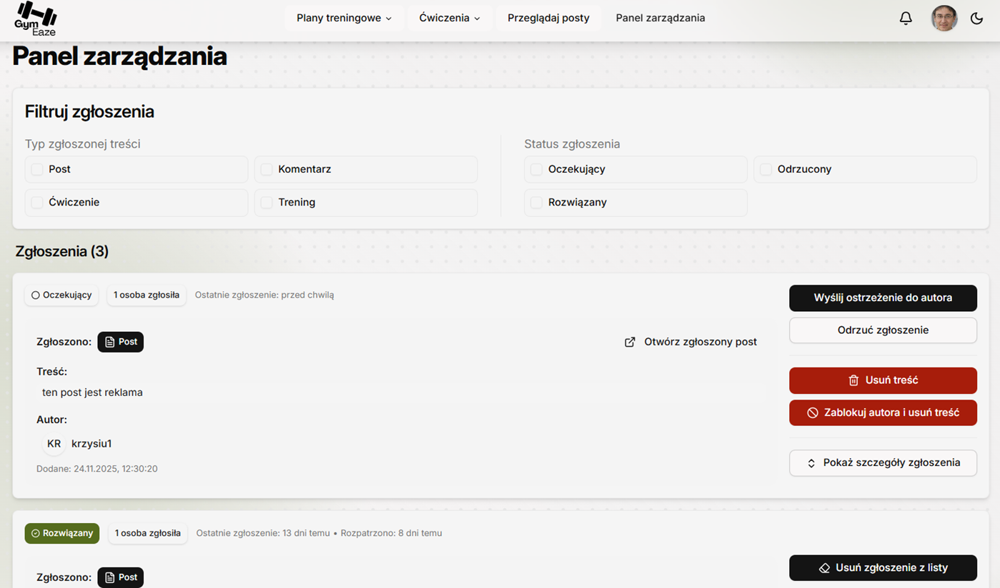
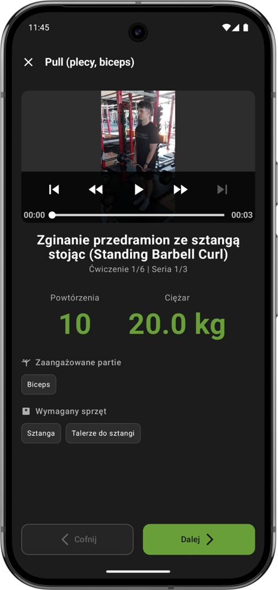
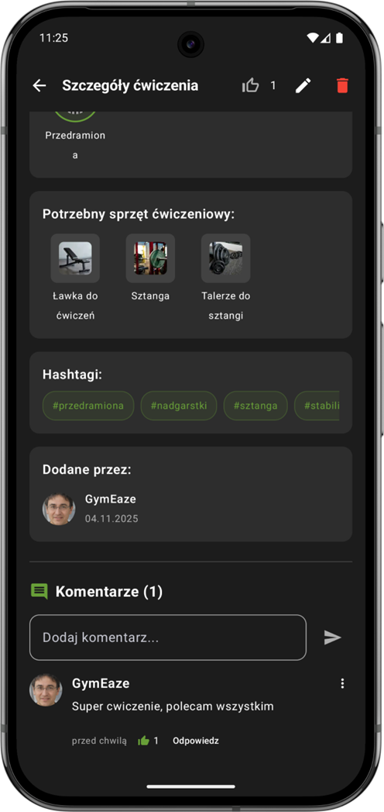
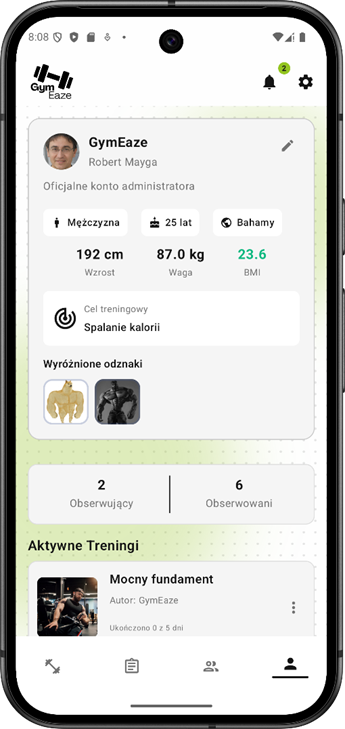

<div align="left">
  <a href="README.pl.md">
    
  </a>
</div>

<br />
<div align="center">

  <table align="center" border="0" cellpadding="0" cellspacing="0">
    <tr>
      <td style="border: none; padding-right: 15px;">
        
      </td>
      <td style="border: none; vertical-align: middle;">
        <h3 style="margin: 0; font-weight: bold;">Comprehensive social platform<br>supporting your workouts.</h3>
      </td>
    </tr>
  </table>

  <p>
    We connect fitness enthusiasts, enabling plan creation, progress tracking, and friendly competition.
  </p>


  <p align="center">
    <a href="#-about-the-project">About</a> •
    <a href="#️-technologies">Technologies</a> •
    <a href="#-features">Features</a> •
    <a href="#-gallery">Gallery</a> •
    <a href="#-getting-started">Getting Started</a> •
    <a href="#-testing">Testing</a> •
    <a href="#-authors">Authors</a>
  </p>
</div>

---

## 📖 About the Project

**GymEaze** is a modern fitness system that combines an advanced workout journal with a social media platform. The application's goal is not only to track results but also to build a community that motivates each other through content sharing, commenting, reacting to content posted by other users, a badge system, personalized training plans, and much more.

### System Architecture

The project was implemented in a three-tier architecture, ensuring scalability and separation of concerns:

1.  **Server Layer (Backend):** Efficient and scalable API implementing core business logic. Ensures high security standards through integration with Google OAuth. Data is stored in a cloud-based MongoDB Atlas database, and multimedia management (photos, videos) is handled through Cloudinary service.
2.  **Web Layer (Frontend):** Modern SPA application built on React and TypeScript. Utilizes component architecture with TailwindCSS and shadcn/ui libraries. The project emphasizes digital accessibility (WCAG) with proper color contrast and full keyboard interface support. React Query handles API communication and server state management, ensuring smooth operation and network query optimization.
3.  **Mobile Layer (Mobile):** Native Android application created in Kotlin using the modern declarative UI framework Jetpack Compose. The project is based on the MVVM architectural pattern, ensuring clean code and easy testing.

---

## 🛠️ Technologies

The project uses a modern technology stack ensuring performance and scalability.

### Backend


### Frontend


### Mobile


---

## ✨ Features

### Access and Personalization

- **Role System**:
  - **Guest**: Ability to browse exercise database, plans, and posts (read-only mode).
  - **Logged-in User**: Full access to interactions, creators, and progress tracking.
- **Cross-Platform**: Ability to be logged in simultaneously on web and mobile applications.
- **User Profile**: Personalization of data (weight, height, goals, BMI), privacy management, avatar, badge pinning, and additional profile information.
- **Themes**: Full support for dark and light themes on both platforms.

### Advanced Planner and Training

- **Comprehensive Plan Creator**: Create plans up to 30 days, divided into weeks, with options to duplicate days/weeks for faster editing.
- **Custom Exercises**: Ability to add custom exercises to global or private database.
- **Content Visibility**: Users decide whether their plan/exercise is public or private.
- **Favorites**: System for saving interesting plans and exercises for later.

### Mobile Assistant (Mobile Only)

- **Step-by-Step Mode**: Interactive workout execution mode. The app guides through exercises, counts rest periods and sets.
- **Progress Tracking**: Marking training days, resetting progress, or removing started plans.
- **Synchronization**: Progress in the mobile app is visible on the web profile.

### Community

- **Interactions**: Like system and two-level comment system (main comment + reply) under posts, plans, and exercises.
- **Following**: Ability to follow other users (Follow/Unfollow) and view their activity and profiles.
- **Gamification**: Earning badges visible in profile (e.g., for account longevity or created plans).

### Admin Panel (Web Only)

- **Moderation**: Removing inappropriate content (posts, exercises, plans, comments).
- **User Management**: Blocking accounts, sending global system notifications.

---

## 📸 Gallery

> Below are the most important views of the application.

### 🖥️ Web Application

<div align="center">

|                           Plan Creator (30 days)                           |                       Profile and Statistics                       |                           Admin Panel                           |
| :------------------------------------------------------------------------: | :----------------------------------------------------------------: | :-------------------------------------------------------------: |
|                   _Plan editing view divided into weeks_                   |              _Profile view with badges and BMI chart_              |                  _Managing reports and users_                   |
|  |  |  |

</div>

### 📱 Mobile Application

<div align="center">

|                            Training Mode (Step-by-step)                             |                          Social Feed & Comments                          |                              Settings and Themes                               |
| :---------------------------------------------------------------------------------: | :----------------------------------------------------------------------: | :----------------------------------------------------------------------------: |
|                              _Active exercise screen_                               |                     _Discussion view under exercise_                     |                       _Light mode and privacy settings_                        |
|  |  |  |

</div>

---

## 🚀 Getting Started

To run the project locally, follow the instructions below for each module.

### Prerequisites

- Node.js (v18+)
- Android Studio (for mobile module)
- MongoDB (local or Atlas)

### Step 0: Clone the Project

```bash
git clone https://github.com/username/gym-eaze.git
cd gym-eaze
```

### Step 1: Configure Google OAuth 2.0

For login to work properly, you need to configure a project in [Google Cloud Console](https://console.cloud.google.com/):

1. Go to **API & Services** > **Credentials**.
2. Click **Create Credentials** > **OAuth client ID**.
3. **Create Android Client**:
   - **Package name**: `com.example.gymeaze`
   - **SHA-1**: Your debug key fingerprint (get it in Android Studio > Gradle > Tasks > android > signingReport).
4. **Create Web Application Client**:
   - **Authorized JavaScript origins**:
     - `http://localhost:5173`
     - `http://localhost`
   - **Authorized redirect URIs**:
     - `http://localhost:5173`
     - `https://developers.google.com/oauthplayground`
5. **Important:** Copy the generated `CLIENT_ID` (Web Application type) – it will be needed in backend, frontend, and mobile app configuration.

### Step 2: Backend (API)

```bash
cd backend
npm install
```

1. Rename the file .env.example to .env.

2. Fill in the keys in .env

3. Start the server:

```bash
npm run dev
```

### Step 3: Frontend (Web)

```bash
cd frontend
npm install
```

1. Rename the file .env.example to .env.

2. Fill in the keys in .env

3. Start the server:

```bash
npm run dev
```

Application available at: http://localhost:5173

### Step 4: Mobile (Android)

1. Navigate to the mobile/ directory.

2. Create a local.properties file (if it doesn't exist) in the main mobile/ directory.

3. Paste and fill in the configuration below:

```bash
## This file is not versioned. Contains local paths and keys.

# Path to SDK (usually auto-generated by Android Studio)
# Windows: C:\Users\YourName\AppData\Local\Android\Sdk
# Mac/Linux: /Users/YourName/Library/Android/sdk
sdk.dir=YOUR_PATH_TO_SDK

# Backend address
# (For Android emulator, localhost is usually 10.0.2.2)
API_URL="http://10.0.2.2:5000"

# Client ID from Google Cloud Console (Web Client ID)
GOOGLE_CLIENT_ID="YOUR_GOOGLE_CLIENT_ID"
```

4. Open the project in Android Studio, wait for Gradle synchronization (this may take a moment), and run the application on an emulator.

## 🧪 Testing

Verification of system functionality was conducted through **manual testing**, covering both business logic and user interface.

### ✅ Testing Scope

- **Backend & API**:
  REST API endpoint verification was performed using **Insomnia** tool. We checked:
  - Correctness of HTTP response codes (200, 400, 401, 500).
  - Security functionality (JWT, authorization middleware).
  - Input data validation (e.g., when creating plans).

- **Key Manual Scenarios**:
  - **Cross-Platform Synchronization**: Creating a plan in the web application and immediately starting a workout in the mobile application.
  - **OAuth 2.0**: Google login and user session refresh.
  - **Multimedia Handling**: Uploading photos and videos to Cloudinary and their proper rendering on different devices.
  - **Admin Panel**: Attempting to access the admin panel from a regular user account (access blocked).
  - **Training Cycle**: Complete step-by-step mode on mobile, from start to saving workout history.

> 💡 **And much more...**
> We've taken care of dozens of small UX/UI details that you'll discover while using the application.

## 👥 Authors

Behind the GymEaze project is a trio of code and sports enthusiasts. Each of us brought different strengths to deliver this project to completion.

<div align="center">

|                 <a href="https://github.com/evee03"></a>                  |                <a href="https://github.com/Squashim"></a>                 |                 <a href="https://github.com/Kuba27x"></a>                 |
| :---------------------------------------------------------------------------------------------------------------------------------------: | :-----------------------------------------------------------------------------------------------------------------------------------------: | :----------------------------------------------------------------------------------------------------------------------------------------: |
|                                                           **Ewelina Musińska**                                                            |                                                             **Konrad Piekarz**                                                              |                                                            **Jakub Pieńkowski**                                                            |
| [](https://github.com/evee03) | [](https://github.com/Squashim) | [](https://github.com/Kuba27x) |

</div>
