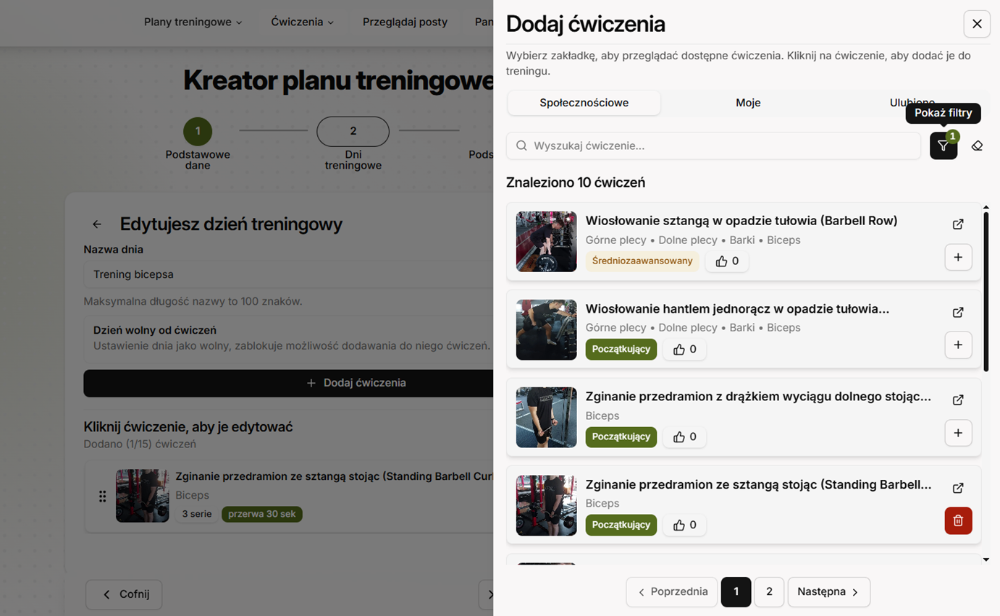
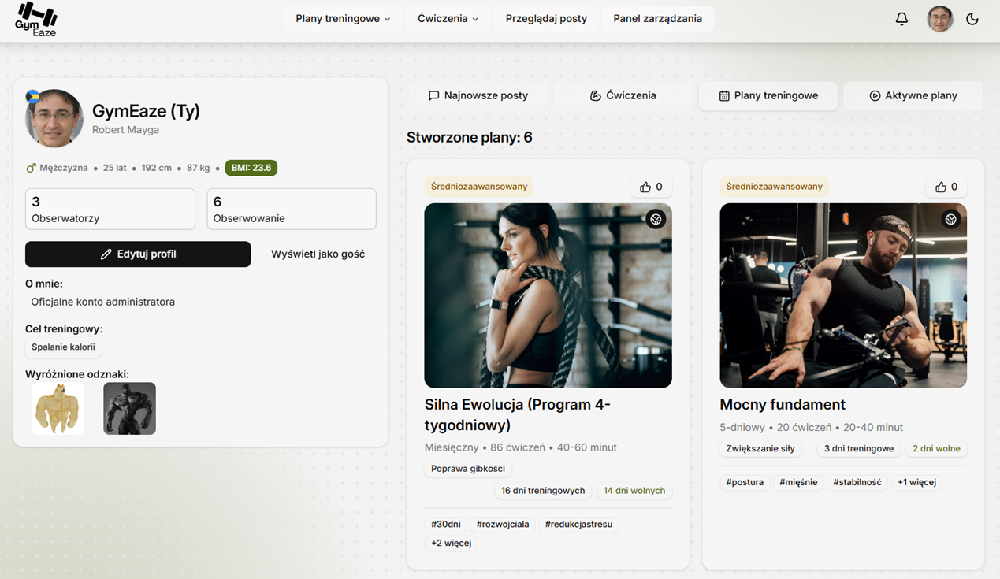
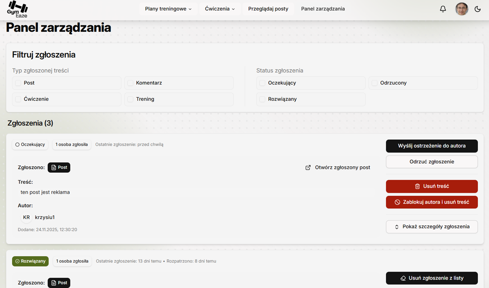
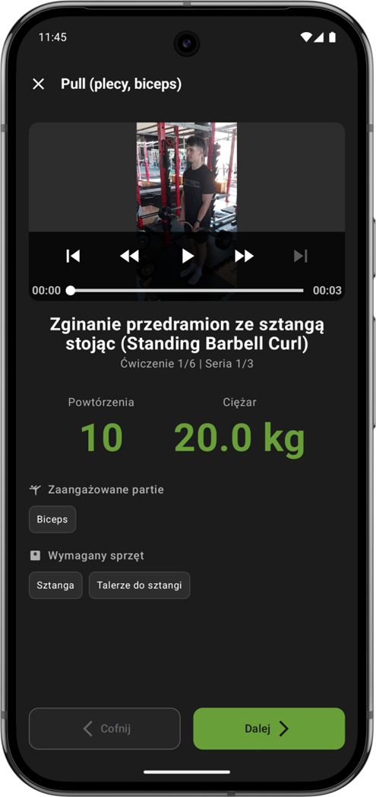
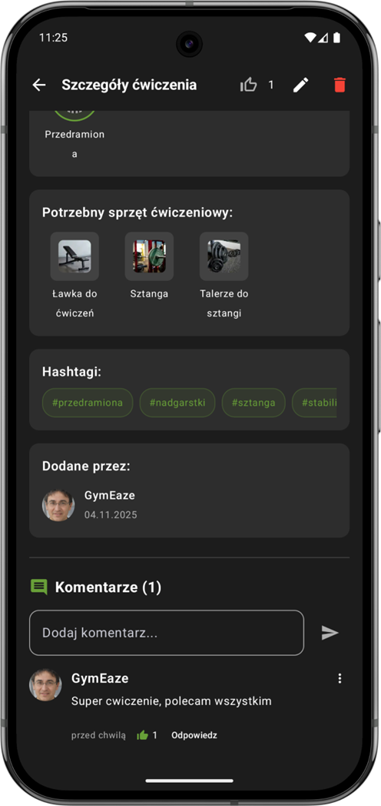
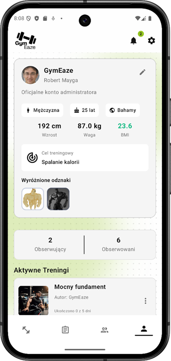

<div align="left">
  <a href="README.md">
    
  </a>
</div>

<br />
<div align="center">

  <table align="center" border="0" cellpadding="0" cellspacing="0">
    <tr>
      <td style="border: none; padding-right: 15px;">
        
      </td>
      <td style="border: none; vertical-align: middle;">
        <h3 style="margin: 0; font-weight: bold;">Kompleksowa platforma społecznościowa<br>wspomagająca treningi.</h3>
      </td>
    </tr>
  </table>

  <p>
    Łączymy entuzjastów fitnessu, umożliwiając tworzenie planów, śledzenie postępów i rywalizację.
  </p>


  <p align="center">
    <a href="#-o-projekcie">O projekcie</a> •
    <a href="#-technologie">Technologie</a> •
    <a href="#-funkcjonalności">Funkcjonalności</a> •
    <a href="#-galeria">Galeria</a> •
    <a href="#-uruchomienie">Uruchomienie</a> •
    <a href="#-testy">Testy</a> •
    <a href="#-autorzy">Autorzy</a>
  </p>
</div>

---

## 📖 O projekcie

**GymEaze** to nowoczesny system fitness, który łączy funkcje zaawansowanego dziennika treningowego z platformą społecznościową. Celem aplikacji jest nie tylko śledzenie wyników, ale także budowanie społeczności, która motywuje się nawzajem poprzez dodawanie treści, komentarzy, reagowanie na zawartość umieszczaną przez innych użytkowników na platformę, system odznak, komentarzy, tworzenie spersonalizowaych planó treningowych i wiele innych.

### Architektura Systemu

Projekt został zrealizowany w architekturze trójwarstwowej, zapewniającej skalowalność i separację odpowiedzialności:

1.  **Warstwa Serwerowa (Backend):** Wydajne i skalowalne API realizujące kluczową logikę biznesową systemu. Zapewnia wysoki standard bezpieczeństwa dzięki integracji z Google OAuth. Dane składowane są w chmurowej bazie MongoDB Atlas, a zarządzanie multimediami (zdjęcia, wideo) odbywa się za pośrednictwem serwisu Cloudinary.
2.  **Warstwa Internetowa (Frontend):** Nowoczesna aplikacja typu SPA zbudowana w oparciu o bibliotekę React i TypeScript. Wykorzystuje architekturę komponentową oraz bibliotekę TailwindCSS i shadcn/ui. Projekt kładzie duży nacisk na dostępność cyfrową (WCAG). Zadbano o odpowiedni kontrast kolorystyczny oraz pełną obsługę interfejsu za pomocą klawiatury. Za komunikację z API i zarządzanie stanem serwera odpowiada React Query, co gwarantuje płynność działania i optymalizację zapytań sieciowych.
3.  **Warstwa Mobilna (Mobile):** Natywna aplikacja na system Android, stworzona w języku Kotlin przy użyciu nowoczesnego deklaratywnego frameworka UI Jetpack Compose. Projekt oparty jest o wzorzec architektoniczny MVVM, co zapewnia czystość kodu i łatwość testowania.

---

## 🛠️ Technologie

Projekt wykorzystuje nowoczesny stack technologiczny zapewniający wydajność i skalowalność.

### Backend


### Frontend


### Mobile


---

## ✨ Funkcjonalności

### Dostęp i Personalizacja

- **System ról**:
  - **Gość**: Możliwość przeglądania bazy ćwiczeń, planów i postów (tryb _read-only_).
  - **Użytkownik zalogowany**: Pełny dostęp do interakcji, kreatorów i śledzenia postępów.
- **Cross-Platform**: Możliwość bycia zalogowanym jednocześnie na aplikacji webowej i mobilnej.
- **Profil Użytkownika**: Personalizacja danych (waga, wzrost, cele, BMI), zarządzanie widocznością danych (prywatność), avatar, przypinanie odznak oraz dodawanie innych informacji o profilu.
- **Motywy**: Pełne wsparcie dla ciemnego i jasnego motywu na obu platformach.

### Zaawansowany Planer i Trening

- **Kompleksowy Kreator Planów**: Tworzenie planów do 30 dni, z podziałem na tygodnie, z opcją duplikowania dni/tygodni dla szybszej edycji.
- **Własne Ćwiczenia**: Możliwość dodawania niestandardowych ćwiczeń do globalnej lub prywatnej bazy.
- **Widoczność Treści**: Użytkownik decyduje, czy jego plan/ćwiczenie jest publiczne czy prywatne.
- **Ulubione**: System zapisywania interesujących planów i ćwiczeń na później.

### Asystent Mobilny (Mobile Only)

- **Tryb "Krok po kroku"**: Interaktywny tryb wykonywania treningu. Aplikacja prowadzi przez ćwiczenia, odlicza czas przerw i serii.
- **Śledzenie Progresu**: Oznaczanie dni treningowych, resetowanie postępów lub usuwanie rozpoczętych planów.
- **Synchronizacja**: Postępy w aplikacji mobilnej są widoczne na profilu webowym.

### Społeczność

- **Interakcje**: System polubień (like) oraz dwupoziomowy system komentarzy (komentarz główny + odpowiedz) pod postami, planami i ćwiczeniami.
- **Obserwacje**: Możliwość śledzenia innych użytkowników (Follow/Unfollow) i przeglądania ich aktywności oraz profili.
- **Grywalizacja**: Zdobywanie odznak widocznych w profilu (np. za długość posiadania konta czy stworzone plany).

### Panel Administracyjny (Web Only)

- **Moderacja**: Usuwanie nieodpowiednich treści (posty, ćwiczenia, plany, komentarze).
- **Zarządzanie Użytkownikami**: Blokowanie kont, wysyłanie globalnych powiadomień systemowych.

---

## 📸 Galeria

> Poniżej przedstawione są najważniejsze widoki aplikacji.

### 🖥️ Aplikacja Webowa

<div align="center">

|                             Kreator Planu (30 dni)                              |                           Profil i Statystyki                            |                               Panel Admina                               |
| :-----------------------------------------------------------------------------: | :----------------------------------------------------------------------: | :----------------------------------------------------------------------: |
|                  _Widok edycji planu z podziałem na tygodnie_                   |                _Widok profilu z odznakami i wykresem BMI_                |                _Zarządzanie zgłoszeniami i użytkownikami_                |
|  |  |  |

</div>

### 📱 Aplikacja Mobilna

<div align="center">

|                            Tryb Treningu (Krok po kroku)                            |                          Social Feed & Komentarze                          |                               Ustawienia i Motywy                                |
| :---------------------------------------------------------------------------------: | :------------------------------------------------------------------------: | :------------------------------------------------------------------------------: |
|                             _Ekran aktywnego ćwiczenia_                             |                      _Widok dyskusji pod ćwiczeniem_                       |                      _Tryb jasny i ustawienia prywatności_                       |
|  |  |  |

## </div>

## 🚀 Uruchomienie

Aby uruchomić projekt lokalnie, postępuj zgodnie z poniższymi instrukcjami dla każdego modułu.

### Wymagania wstępne

- Node.js (v18+)
- Android Studio (dla modułu mobile)
- MongoDB (lokalnie lub Atlas)

### Krok 0: Pobranie projektu

```bash
git clone [https://github.com/nazwa_uzytkownika/gym-eaze.git](https://github.com/nazwa_uzytkownika/gym-eaze.git)
cd gym-eaze
```

### Krok 1: Konfiguracja Google OAuth 2.0

Aby logowanie działało poprawnie, musisz skonfigurować projekt w [Google Cloud Console](https://console.cloud.google.com/):

1. Przejdź do **API & Services** > **Credentials** (Dane logowania).
2. Kliknij **Create Credentials** > **OAuth client ID**.
3. **Stwórz Klienta Android**:
   - **Nazwa pakietu**: `com.example.gymeaze`
   - **SHA-1**: Twój odcisk klucza debuggowania (uzyskasz go w Android Studio > Gradle > Tasks > android > signingReport).
4. **Stwórz Klienta Aplikacji Internetowej (Web Client)**:
   - **Authorized JavaScript origins**:
     - `http://localhost:5173`
     - `http://localhost`
   - **Authorized redirect URIs**:
     - `http://localhost:5173`
     - `https://developers.google.com/oauthplayground`
5. **Ważne:** Skopiuj wygenerowany `CLIENT_ID` (Typu "Web Application") – będzie on potrzebny w konfiguracji backendu, frontendu oraz aplikacji mobilnej.

### Krok 2: Backend (API)

```bash
cd backend
npm install
```

1. Zmień nazwę pliku .env.example na .env.

2. Uzupełnij klucze w .env

3. Uruchom serwer:

```bash
npm run dev
```

### Krok 3: Frontend (Web)

```bash
cd frontend
npm install
```

1. Zmień nazwę pliku .env.example na .env.

2. Uzupełnij klucze w .env

3. Uruchom serwer:

```bash
npm run dev
```

Aplikacja dostępna pod adresem: http://localhost:5173

### Krok 4: Mobile (Android)

1. Przejdź do katalogu mobile/.

2. Utwórz plik local.properties (jeśli nie istnieje) w głównym katalogu mobile/.

3. Wklej i uzupełnij poniższą konfigurację:

```bash
## Ten plik nie jest wersjonowany. Zawiera lokalne ścieżki i klucze.

# Ścieżka do SDK (zazwyczaj Android Studio generuje ją automatycznie)
# Windows: C:\Users\TwojaNazwa\AppData\Local\Android\Sdk
# Mac/Linux: /Users/TwojaNazwa/Library/Android/sdk
sdk.dir=TWOJA_SCIEZKA_DO_SDK

# Adres backendu
# (Dla emulatora Androida localhost to zazwyczaj 10.0.2.2)
API_URL="[http://10.0.2.2:5000](http://10.0.2.2:5000)"

# Klient ID z Google Cloud Console (Web Client ID)
GOOGLE_CLIENT_ID="TWOJ_GOOGLE_CLIENT_ID"
```

4. Otwórz projekt w Android Studio, poczekaj na synchronizację Gradle (może to chwilę potrwać) i uruchom aplikację na emulatorze.

## 🧪 Testy

Weryfikacja poprawności działania systemu została przeprowadzona w procesie **testów manualnych**, obejmujących zarówno warstwę logiczną, jak i interfejs użytkownika.

### ✅ Zakres testów

- **Backend & API**:
  Weryfikacja endpointów REST API została przeprowadzona przy użyciu narzędzia **Insomnia**. Sprawdzono:

  - Poprawność kodów odpowiedzi HTTP (200, 400, 401, 500).
  - Działanie zabezpieczeń (JWT, middleware autoryzacji).
  - Walidację danych wejściowych (np. przy tworzeniu planów).

- **Kluczowe scenariusze manualne**:
  - **Synchronizacja Cross-Platform**: Utworzenie planu w aplikacji webowej i natychmiastowe podjęcie treningu w aplikacji mobilnej.
  - **OAuth 2.0**: Logowanie przez Google oraz odświeżanie sesji użytkownika.
  - **Obsługa Multimediów**: Przesyłanie zdjęć i wideo do Cloudinary oraz ich poprawne renderowanie na różnych urządzeniach.
  - **Panel Administratora**: Próba dostępu do panelu admina z poziomu zwykłego użytkownika (blokada dostępu).
  - **Cykl Treningowy**: Przejście pełnego trybu "krok po kroku" na mobile, od startu do zapisania historii treningu.

> 💡 **Oraz wiele więcej...**
> Zadbaliśmy o dziesiątki drobnych detali UX/UI, które odkryjesz podczas korzystania z aplikacji.

## 👥 Autorzy

Za projektem GymEaze stoi trójka entuzjastów kodu i sportu. Każdy z nas wniósł inny ciężar, aby dowieźć ten projekt do końca.

<div align="center">

|                 <a href="https://github.com/evee03"></a>                  |                <a href="https://github.com/Squashim"></a>                 |                 <a href="https://github.com/Kuba27x"></a>                 |
| :---------------------------------------------------------------------------------------------------------------------------------------: | :-----------------------------------------------------------------------------------------------------------------------------------------: | :----------------------------------------------------------------------------------------------------------------------------------------: |
|                                                           **Ewelina Musińska**                                                            |                                                             **Konrad Piekarz**                                                              |                                                            **Jakub Pieńkowski**                                                            |
| [](https://github.com/evee03) | [](https://github.com/Squashim) | [](https://github.com/Kuba27x) |

</div>
